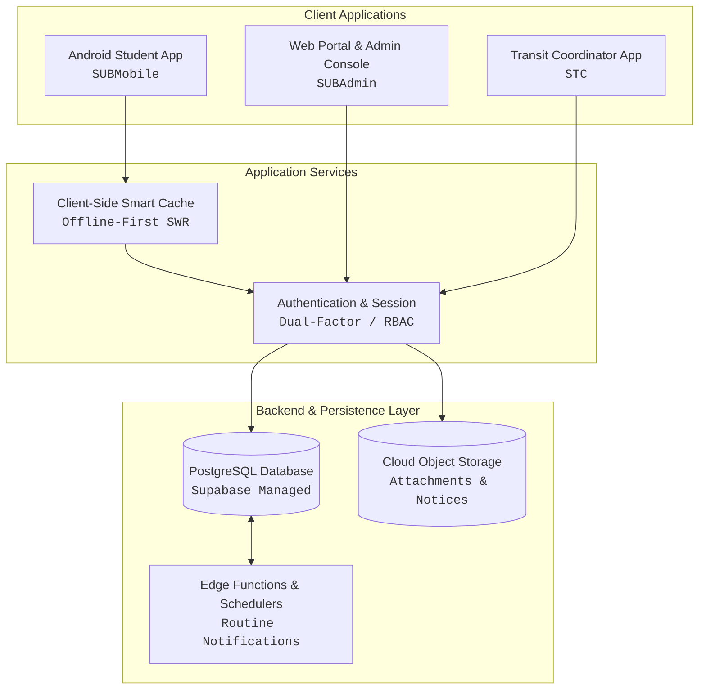

<div align="center">

# SUBTools Ecosystem

### Unified Campus Management, Academic Routine & Transit Logistics Platform

<p align="center">
  <a href="LICENSE"></a>
  
  
  
  
  <a href="CONTRIBUTING.md"></a>
</p>

<p align="center">
  An integrated suite of multi-platform applications architected for <b>State University of Bangladesh (SUB)</b>, streamlining academic scheduling, live campus transit telemetry, exam routine distribution, PDF report generation, and role-based administrative control.
</p>

<p align="center">
  <a href="https://github.com/AkonMHasib/SUBTools/releases/latest/download/app-release.apk">
    
  </a>
  &nbsp;&nbsp;
  <a href="https://sub-tools.vercel.app">
    
  </a>
</p>

---

</div>

## 🚀 Quick Access & Downloads

| Platform | Access Method | Target Audience | Direct Link |
|---|---|---|---|
| **Android** | Native Mobile APK | Students, Faculty | [📥 **Download Latest APK (`app-release.apk`)**](https://github.com/AkonMHasib/SUBTools/releases/latest/download/app-release.apk) |
| **iOS / iPadOS** | Web Portal (PWA Supported) | iPhone, iPad users | [🌐 **Browse on iOS (`sub-tools.vercel.app`)**](https://sub-tools.vercel.app) |
| **Desktop / PC** | Web Portal & Admin Console | Students, Teachers & Admins | [💻 **Open Web Dashboard**](https://sub-tools.vercel.app) |

> [!TIP]
> **For iOS Users**: Open [sub-tools.vercel.app](https://sub-tools.vercel.app) in **Safari**, tap the **Share** button, and select **"Add to Home Screen"** to install SUBTools as a standalone progressive web app with a full-screen experience.

---

## Table of Contents
- [Quick Access & Downloads](#-quick-access--downloads)
- [Executive Overview](#-executive-overview)
- [System Architecture](#-system-architecture)
- [Monorepo Workspace Modules](#-monorepo-workspace-modules)
  - [1. SUBMobile (Android Client)](#1-submobile-android-client)
  - [2. SUBAdmin (Web Portal & Admin Console)](#2-subadmin-web-portal--admin-console)
  - [3. STC (Transit & Logistics Coordinator)](#3-stc-transit--logistics-coordinator)
- [Security & Decoupled Configuration](#-security--decoupled-configuration)
- [Local Development Setup](#-local-development-setup)
- [Contributing](#-contributing)
- [License & Intellectual Property](#-license--intellectual-property)

---

## 🏛 Executive Overview

The **SUBTools** platform addresses daily academic friction points for university students, educators, and campus administrators through a centralized, high-availability architecture:

- **Dynamic Class Routines**: Real-time routine resolution by batch, section, and intake with auto-conflict detection.
- **Smart Campus Transit**: Real-time fleet schedule tracking and dispatch telemetry across university bus routes.
- **Automated Academic Utilities**: Instant PDF cover page generation (lab reports, assignments), degree credit tracking, and CGPA estimation.
- **Role-Based Web Portal**: Unified student services and fine-grained administrative dashboard with dual-factor authentication (2FA), activity audit trails, and automated notices.

---

## 🏗 System Architecture



---

## 📦 Monorepo Workspace Modules

### 1. `SUBMobile` (Android Client)
A modern native Android client crafted for student workflows:
- **Offline-First Synchronization**: Caches daily classes, room allocations, and bus schedules locally.
- **Exam Routine Isolation**: Dynamically locks regular routines during active semester exam schedules.
- **Assignment & Lab Cover Generator**: Generates formatted, ready-to-print submission covers directly on-device.
- **Campus Notice Push**: Real-time push broadcasts for university events and emergency notifications.

### 2. `SUBAdmin` (Web Portal & Admin Console)
A reactive, responsive web application serving dual roles:
- **Student Web Dashboard**: Provides students with complete schedule visibility, degree credit requirements, and academic tools in browser.
- **Administrative Control Panel**:
  - Department credit requirement configuration and degree audit limits.
  - Granular Role-Based Access Control (RBAC) with immutable activity audit logs.
  - Two-Factor Authentication (2FA) verification layer for super administrators.
  - Dynamic ad display controls and analytics telemetry.

### 3. `STC` (Transit & Logistics Coordinator)
Dedicated operations application for campus logistics:
- Real-time route tracking, bus driver coordination, and schedule adjustments.
- Instant notifications to student devices regarding transit route delays or route updates.

---

## 🛡 Security & Decoupled Configuration

This repository adopts a **Zero-Secret Public Architecture**:
- All production API keys, database credentials, server secrets, and signing keystores (`.jks`, `.keystore`) are excluded from version control via `.gitignore`.
- Development is completely decoupled: contributors supply their own local environment variables or mock instances without gaining access to production student data or university infrastructure.

---

## 💻 Local Development Setup

### Prerequisites
- **Web**: Node.js 18+ or 20+, npm 9+
- **Android**: Android Studio (Koala / Ladybug or newer), JDK 17, Android SDK 34+

### Web Portal (`SUBAdmin`)
```bash
# 1. Switch to the web workspace
cd SUBAdmin

# 2. Copy the sample environment template
cp .env.example .env

# 3. Configure your local or staging backend in .env
# Open .env and replace placeholders with your Supabase credentials

# 4. Install dependencies and start development server
npm install
npm run dev
```

### Mobile App (`SUBMobile`)
```bash
# 1. Open SUBMobile directory in Android Studio
# 2. Copy the example secrets configuration
cp SUBMobile/secrets.properties.example SUBMobile/secrets.properties

# 3. Fill in your development Supabase credentials in secrets.properties
# 4. Sync Gradle project and launch on an emulator or connected device
```

---

## 🤝 Contributing

We welcome community pull requests, bug fixes, UI improvements, and feature proposals!

Please consult our [Contributing Guidelines](CONTRIBUTING.md) before submitting code:
1. Fork the project and branch from `main`.
2. Follow standard conventional commit guidelines.
3. Ensure all tests and static analysis checks pass cleanly.
4. Open a descriptive Pull Request detailing the problem solved and test cases verified.

---

## ⚖️ License & Intellectual Property

This project is governed by the **[SUBTools Community Source & Non-Commercial License](LICENSE)**:

- ❌ **Commercial Prohibition**: You may not sell, lease, sublicense, monetize, or rebrand any portion of this software or its binaries.
- ❌ **No Unauthorized Distribution**: You may not distribute white-labeled copies to public application marketplaces (Google Play Store, App Store) or host commercial SaaS portals.
- ✔️ **Permitted Uses**: Code review, educational analysis, local personal evaluation, and community contributions to the official repository.

**Copyright © 2024–2026 Akon M Hasib / SUBTools Project Contributors. All rights reserved.**
